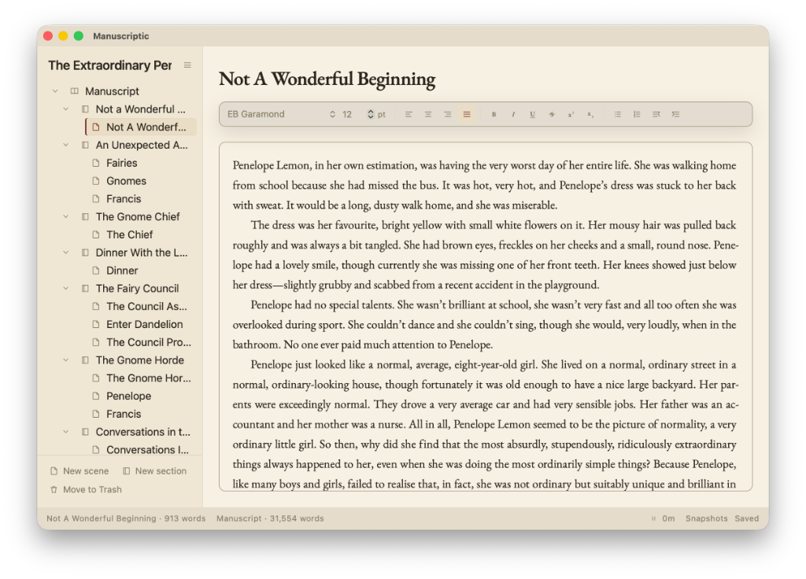

# Manuscriptic

Manuscriptic is a writing app for authors, made for the long work of a novel. Rich text lets you control headings, fonts, and style. Compile can override those editor settings to match a publisher's guide.

I use it for my own books. I run it on a Mac. Windows builds are on the releases page. Linux is untested.

## Download

The latest build is on the [releases page](https://github.com/rgarth/manuscriptic/releases). On a Mac, take the Apple Silicon disk image. On Windows, take the ARM64 executable for an ARM PC, or the x64 executable for an Intel or AMD PC.

## Features

- A binder for the manuscript. Sections and scenes, in whatever order the book wants, and you can drag them into place.
- Notes beside the draft, for characters, places, research, and anything else.
- Publishing pages for the work around the book: title page, copyright, dedication, epigraph, synopsis, query, acknowledgements, about the author, and a back page.
- Rich text support.
- Typewriter mode, which holds the line you are writing in the middle of the screen.
- Statistics. The open scene and the whole manuscript each show a word count. A clock tracks this sitting, the words written in it, and how long you have written today. It counts while the window is in front and the page has changed in the last five minutes.
- Inline spellchecker.
- Themes: Parchment, Chamomile, Rosewater, Bluebell, Sage, Ink, Midnight, Leather, and Typewriter.
- Export to a Word document (`.docx`) for a submission, for another app, or for a backup. Choose which pages go in, how chapters and scenes are headed, and the spacing and page numbers. Your author details can fill the title page.
- You can import a project from Scrivener.
- Snapshots. The book keeps a history, and you can roll it back. That is covered under built-in backups.

The book is one file. It saves itself while you work.

## Built-in backups

Snapshots are a history of the book, kept inside the file.

Take one yourself before a rewrite. A snapshot you take is kept until you delete it. Automatic snapshots run on a timer, every five minutes, every fifteen, or every hour, and you can turn them off. The automatic ones thin out as they age: recent history stays close together, and the older stretches keep less of it.

Roll the whole book back to a snapshot, or roll back only the scene you have open.

## No support, no warranty

There is no support. There is no warranty.

I am not responsible if Manuscriptic shreds your next bestselling idea, or your lifetime opus. Keep your own copies of the work.

## Licence

[MIT](LICENSE).

## Building it

See [INSTALL.md](INSTALL.md).
